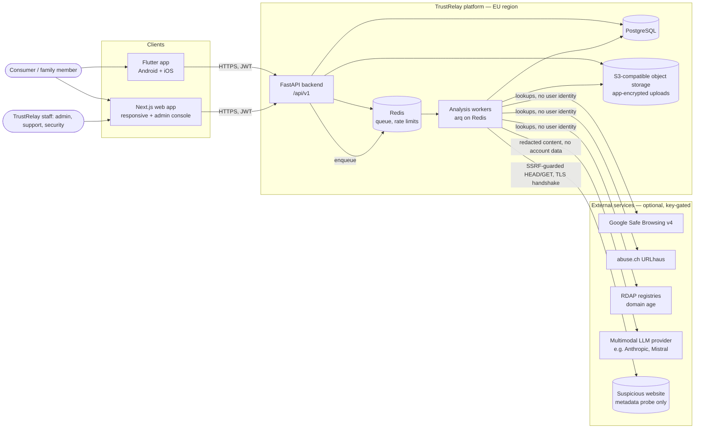
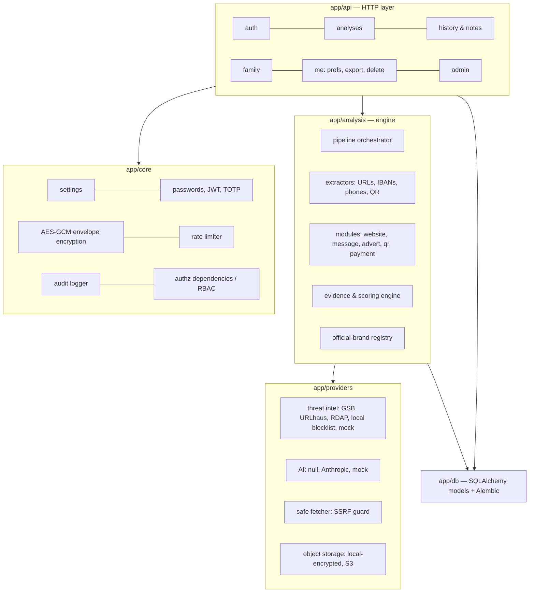

# 01 — System and component architecture

Status: **IN PROGRESS** (Phase 1). This document is the reference design; where the code differs, the code
and `docs/STATUS.md` say what is actually built.

## 1. Goals that drive the architecture

| Goal | Architectural consequence |
|---|---|
| Never over-claim safety | Verdicts are one of five evidence categories, never a "safe" score. The scoring engine is deterministic and explainable; AI output can only add evidence, never remove it. |
| Privacy by design (GDPR) | Submitted content is encrypted at the application layer; admins see aggregates, not content; per-user retention; export and deletion endpoints. |
| Treat every input as hostile | Uploads re-encoded, URL fetching only through an SSRF-guarded client, LLM prompts isolate user content and outputs are schema-validated. |
| Android, iOS and web from one backend | A single versioned REST API (`/api/v1`) with OpenAPI; localized text served by the backend so every client shows identical explanations. |
| FR + EN now, more later | All user-facing finding text is generated from message codes and catalogs (`backend/app/i18n`, `web/src/i18n`, `mobile/lib/l10n`). Adding a language means adding catalogs, not code. |
| Swap vendors without rewrites | Provider interfaces for AI models, threat-intelligence sources, object storage, rate-limit store and job queue. |

## 2. System context

## 3. Components (backend)

Module boundaries are enforced by convention: `app/analysis` never imports `app/api`; providers never import models.
Every analysis module implements the same interface (`AnalysisModule.run(context) -> list[Finding]`), so modules are
independently testable and can be enabled or disabled through feature flags.

## 4. Technology evaluation and choices

The repository was empty when Phase 1 started, so there was no existing stack to respect.

| Concern | Options considered | Choice | Reason |
|---|---|---|---|
| Mobile | Flutter, React Native, native Kotlin/Swift | **Flutter** | One codebase for Android and iOS, strong accessibility and i18n (ARB), mature camera/QR plugins. React Native would allow sharing TS with web, but Flutter gives more consistent UI and was the suggested stack. |
| Web | Next.js (TS), SvelteKit, Remix | **Next.js + TypeScript** | Same app hosts the public website later (Phase 5) with SSR/SEO, plus the authenticated app and admin console. Large hiring pool. |
| Backend | FastAPI, Django, NestJS, Go | **Python + FastAPI** | Native fit for the ML/NLP ecosystem, async I/O for many outbound lookups, Pydantic validation, automatic OpenAPI. Django was close (admin, ORM) but its admin would give staff raw data access, which we want to avoid by design. |
| Database | PostgreSQL, MySQL | **PostgreSQL 16** | JSONB for evidence, strong constraints, row-level security available later, managed offerings at OVHcloud/Scaleway. |
| Queue | arq, Celery, RQ, Dramatiq | **arq (Redis)** | Async-native (same code path as the API), small. Celery is heavier and sync-first. |
| Object storage | S3-compatible (Scaleway, OVH, MinIO local) | **S3 API + app-level AES-GCM** | Provider-portable; encryption does not depend on the provider's server-side encryption. |
| Auth | Self-hosted IdP (Keycloak, Zitadel), managed (Auth0, Cognito), built-in | **Built-in OAuth2-style token service now, OIDC IdP later** | See `04-authentication.md`. Phase 1 ships first-party password + TOTP with short-lived JWTs and rotating refresh tokens. Token claims are OIDC-shaped so a move to Zitadel/Keycloak (EU-hostable) changes the issuer, not the clients. |
| AI | Single vendor SDK vs abstraction | **Provider abstraction** | `AIProvider` interface with `null` (rules only), `mock` and `anthropic` implementations. Mistral (EU vendor) is a natural second implementation. |
| Hosting | OVHcloud, Scaleway, AWS/Azure/GCP EU | **Decision deferred to Phase 5** | Docker images are provider-neutral. Data residency alone does not make the service GDPR-compliant; transfer and sub-processor analysis is required. |

## 5. Request lifecycle of an analysis

1. Client sends `POST /api/v1/analyses` with `kind` (`url`, `message`, `advert`, `payment`, `qr`, `image`) and either text/URL
   or an `upload_id` from `POST /api/v1/uploads`.
2. API validates input (Pydantic, length caps, URL syntax), checks quota and rate limit, encrypts the raw content, stores
   an `analyses` row with status `queued`, and enqueues a job. In development and tests the job can run inline.
3. Worker decrypts content in memory, runs extractors, selects modules from `kind` plus what was extracted (a message
   containing a link also runs the website module), calls threat-intel providers and the optional AI provider with timeouts,
   then the scoring engine produces the verdict.
4. Findings are stored as structured rows (codes + parameters, evidence, source, checked_at, confidence, limitations,
   recommended action). Localized text is rendered at read time in the caller's language.
5. Client polls `GET /api/v1/analyses/{id}` (status `queued → processing → completed | failed`).

## 6. Cross-cutting decisions

- **API versioning:** URL prefix `/api/v1`. Breaking changes require `/api/v2`.
- **Errors:** RFC 9457 problem details (`application/problem+json`).
- **IDs:** UUIDv4 primary keys; never sequential IDs in URLs.
- **Time:** all timestamps UTC, ISO 8601.
- **Configuration:** 12-factor environment variables (`backend/.env.example`), no secrets in Git.
- **Observability:** structured JSON logs without message content; request IDs; `/healthz` and `/readyz`.
