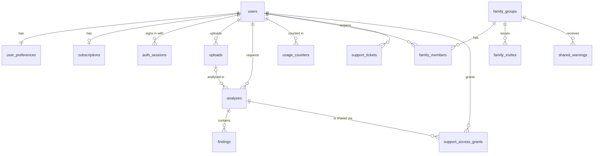

# 02 — Database schema

Status: **TESTING** — implemented in `backend/app/db/models.py`, migration `backend/alembic/versions/0001_initial_schema.py`.
Verified: `alembic upgrade head`, `downgrade base`, `upgrade head` again, and `alembic check` (models and migration in sync)
on PostgreSQL 16. Every backend test runs against a freshly migrated database.

## Conventions

- PostgreSQL 16, UUIDv4 primary keys, `timestamptz` in UTC, `snake_case`.
- **Content columns end in `_enc`**: anything a user submitted or wrote (URLs, messages, notes, ticket bodies, AI
  evidence, TOTP secret) is encrypted by the application with AES-256-GCM before it reaches the database. The
  ciphertext is bound to its row and column (associated data `analysis:{id}:{field}`), so it cannot be copied to
  another row and still decrypt. Keys come from `TR_ENCRYPTION_KEYS` (key ring with rotation: first key encrypts, all
  keys decrypt). A database dump alone does not reveal content.
- Enumerations are enforced with `CHECK` constraints, not only in Python.
- Deleting a user cascades to all of their personal rows (see "Deletion" below).

## Entity relationship overview

## Tables

| Table | Purpose | Notable columns and rules |
|---|---|---|
| `users` | Accounts | `email` unique case-insensitively (`uq_users_email_lower`); `password_hash` (Argon2id); `role` ∈ user, support, security, admin; `locale` ∈ fr, en; `totp_secret_enc`, `totp_enabled`, `totp_last_step` (replay protection); `failed_logins`, `locked_until` (lockout); `onboarding_completed_at` |
| `user_preferences` | Privacy and UX choices | `retention_days` ∈ 0, 30, 90, 365 (default 90); `explanation_level` ∈ simple, standard, detailed; `allow_ai_processing` (default **false**, opt-in); `product_analytics_opt_in` (default **false**); notification toggles |
| `subscriptions` | Plan per user | `plan` ∈ free, plus, family, business, enterprise; `status`; `source` ∈ manual, stripe (only `manual` is implemented — no payments in Phase 1) |
| `auth_sessions` | Refresh-token sessions | `refresh_token_hash` (SHA-256, the token itself is never stored); `chain_id` groups rotations for reuse detection; `client` web/mobile; `revoked_at`, `rotated_at`, `expires_at` |
| `uploads` | Screenshot/QR images | `storage_key` to the encrypted object (re-encoded PNG); size and dimensions; `expires_at` |
| `analyses` | One check | `kind` ∈ url, message, advert, payment, qr, image; `status` ∈ queued, processing, completed, failed; `verdict` (5 categories); `confidence`; `input_enc`, `label_enc`, `result_enc`, `note_enc`; `modules_run`, `sources_checked` (source names, success, time — no content); `ai_used`; `expires_at` (from retention) |
| `findings` | Evidence items | `module`, `code` (closed vocabulary), `severity` ∈ known_malicious, strong, moderate, info; `confidence`; `source`; `checked_at`; `ai_generated`; `details_enc` (evidence snippets) |
| `usage_counters` | Monthly quota | (`user_id`, `period` "YYYY-MM") → `checks` |
| `family_groups`, `family_members`, `family_invites` | Family protection | member `role` ∈ owner, guardian, member; `age_band` ∈ child, teen, adult, senior; `receive_warnings`, `can_share_warnings`; invites store only a hash of the code, single-use, 7-day expiry |
| `shared_warnings` | What a member shared | Only `kind`, `verdict`, `finding_codes` and an optional encrypted message — **never the original content** |
| `support_tickets` | Support requests | `subject_enc`, `body_enc`; category, priority, status enums |
| `support_access_grants` | User-issued, time-limited permission for support to view one analysis | `expires_at`, `revoked_at`; every staff view is audited |
| `audit_logs` | Security and admin events | append-only (see below); `ip_hash` is an HMAC of the IP, never the raw IP; `details` JSON is filtered to forbid content keys |
| `feature_flags`, `system_config` | Admin-managed switches | e.g. `module.ai`, `module.website` |
| `threat_source_health` | Per-source success/failure counters and last error | used by the admin "Threat sources" tab |
| `ai_usage` | Tokens, estimated cost, latency, success per AI call | no prompt or output content |
| `error_events` | Route and error type of unhandled errors | no request bodies |

## Append-only audit log

A trigger (`audit_logs_guard`) rejects `UPDATE` always, and `DELETE` unless the transaction sets
`SET LOCAL trustrelay.audit_purge = 'on'`, which only the retention job does. Tested in
`tests/test_api.py::test_audit_log_is_append_only`.

## Retention and deletion

- `analyses.expires_at` = creation + `retention_days` (0 ⇒ input is never stored and the result expires after 24 h).
  Shortening retention in settings shortens existing `expires_at` values.
- A daily job (`app.worker` cron 03:15 UTC, or `python -m app.cli purge`) deletes expired analyses, findings, uploads
  and stored image objects.
- Account deletion (`POST /me/delete`) deletes the user row; foreign keys cascade to preferences, subscription,
  sessions, uploads, analyses, findings, usage, memberships, invites created, tickets and grants. Stored image objects
  are deleted explicitly. Rows that other people legitimately keep (`shared_warnings.shared_by`) are set to `NULL`.
  Audit records keep the event but not personal content.

## Not yet in the schema (later phases)

Payment provider data (Phase 5), email verification and password-reset tokens (needs an email provider), push
notification tokens, benchmark datasets (Phase 2).
