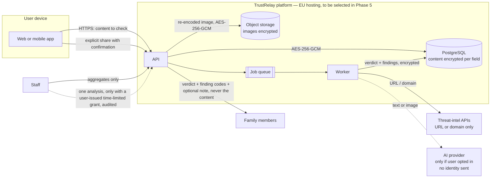

# 06 — Privacy and data flows

Status: **TESTING** for the technical controls. **Legal review has not happened.** Nothing in this repository is a
claim of GDPR compliance; it describes privacy-by-design measures that a qualified reviewer must assess (risk R-01).

## 1. Data flow

## 2. Personal data inventory

| Data | Why | Where | Retention |
|---|---|---|---|
| Email, password hash, display name, locale | Account | `users` | Until account deletion |
| TOTP secret | Two-factor authentication | `users.totp_secret_enc` (encrypted) | Until disabled or deletion |
| Submitted content (URLs, messages, screenshots), labels, notes | The service itself | `analyses.*_enc`, encrypted image objects | User choice: 0 (not stored; result 24 h), 30, 90 (default) or 365 days |
| Findings evidence | Explaining the result | `findings.details_enc` | Same as the analysis |
| Session metadata (client, user agent, times) | Security, "signed-in devices" | `auth_sessions` | Until expiry/revocation, then deleted with the account |
| IP address | Abuse prevention | Only an HMAC (`audit_logs.ip_hash`), raw IPs are not stored by the app | Audit retention policy (to be set, risk R-09) |
| Family membership, shared warnings | Family protection | family tables | Until leaving the group or deletion |
| Support tickets | Support | `support_tickets` (encrypted subject/body) | To be defined (R-09) |
| AI usage, errors, source health | Operations, cost control | aggregate tables, no content | To be defined (R-09) |

Product analytics are **off by default** and nothing is collected yet (`product_analytics_opt_in` is stored for the
future). No third-party trackers, fonts or scripts are loaded by the web app (strict CSP `default-src 'self'`).

## 3. Controls implemented and tested

| Control | Where | Test |
|---|---|---|
| Field-level encryption of all user content, bound to row and field | `app/core/crypto.py`, `services/analysis_service.py` | `test_content_is_encrypted_at_rest` |
| Encrypted image storage after re-encoding | `core/storage.py`, `services/uploads.py` | `test_upload_and_image_analysis_without_ai` |
| Retention choice, shortening applies to existing data, daily purge | `services/analysis_service.py`, `worker.py` | `test_retention_zero_drops_content_and_purge`, `test_shortening_retention_updates_existing_rows` |
| Data export (JSON, decrypted, machine-readable) | `GET /me/export` | `test_export_contains_decrypted_data` |
| Account deletion with full cascade and object deletion | `POST /me/delete` | `test_account_deletion_removes_everything` |
| Admins never see content | `routes/admin.py` | `test_admin_never_sees_content` |
| Support access only by user grant, expiring, audited | `routes/support.py` | `test_support_needs_customer_grant_to_view_analysis` |
| Family sharing excludes original content; explicit confirmation | `routes/analyses.py`, `routes/family.py` | `test_family_invite_join_share_and_privacy` |
| AI opt-in, admin switch, budget cap | `services/analysis_service.py` | `test_ai_disabled_by_user_preference_is_respected`, `test_ai_budget_cap_is_enforced` |
| Logs exclude content | `core/audit.py` forbids content keys; errors log only type and route | code review |

## 4. Open items for legal and DPO review (not done)

- Lawful basis per processing purpose, records of processing (Art. 30), DPIA (likely required: large-scale processing
  of communications content, possibly of children via family groups).
- Children: family groups support a `child` age band; parental consent and age rules (France: 15) need legal review
  before children can have accounts.
- Sub-processors and transfers: hosting, AI provider, threat-intel providers (Google, abuse.ch), email provider.
- Privacy policy, terms of service, cookie notice (the web app sets only a strictly necessary refresh-token cookie).
- Retention periods for audit logs, tickets and operational tables.
- Rights handling beyond export and deletion (rectification, objection) and response procedures.
